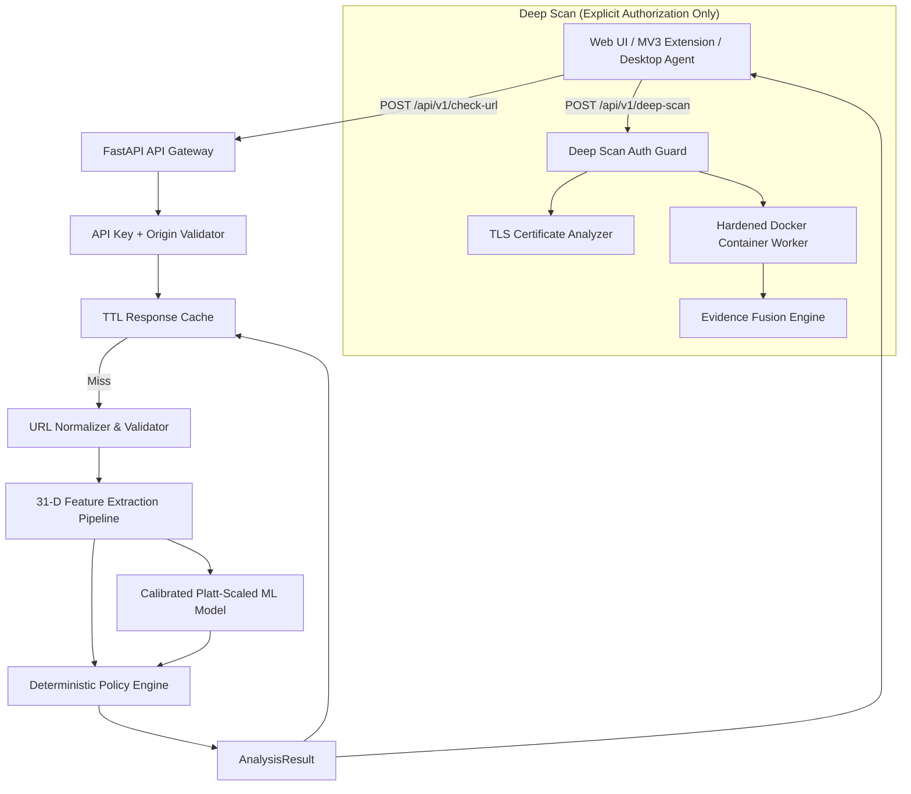

# PhishGuard 🛡️ — AI-Powered Zero-Hour Phishing Threat Detection

[](https://www.python.org/downloads/)
[](https://fastapi.tiangolo.com)
[](https://pytest.org)
[](LICENSE)

PhishGuard is an enterprise-grade, zero-hour phishing detection system architected for ultra-low latency, zero network exposure during preliminary evaluation, and deterministic threat mitigation.

---

## ⚡ Core Principles & Architectural Tenets

1. **Quick Scan by Default (<10ms, No SSRF)**
   - Operates strictly on the URL string using **31 static lexical and structural features** and offline machine learning classification.
   - **Zero network requests** are dispatched during Quick Scan, eliminating Server-Side Request Forgery (SSRF) vulnerabilities.
2. **Deep Scan is Strictly Optional & Sandboxed**
   - Headless browser rendering and TLS handshake verification occur exclusively upon explicit user authorization.
   - Executes inside an isolated, non-root, egress-firewalled Chromium container with CPU and memory limits.
3. **Decoupled Security Decisioning**
   - `phishing_probability` (statistical ML confidence), `risk_score` (0-100 composite), `verdict` (`no_known_threat`, `suspicious`, `high_risk`, `phishing`), and `action` (`allow`, `warn`, `block`) are kept strictly separated.
   - High-confidence deterministic indicators (raw IP addresses, embedded credentials, brand domain spoofing, homoglyphs) override statistical model outputs.
4. **Isolated Training & Inference Boundaries**
   - `backend/training/` owns dataset curation, model training, cross-validation, and evaluation.
   - `backend/app/ml/` owns runtime inference, ensuring production zero-dependency stability.
5. **Defense-in-Depth Authentication**
   - Local binding (`127.0.0.1`) is paired with API key validation (`X-API-Key`) and browser `Origin` verification to prevent unauthorized local cross-site exploitation.

---

## 🏛️ System Architecture



---

## 📁 Repository Structure

```text
phishguard/
├── backend/
│   ├── app/
│   │   ├── main.py                  # FastAPI application entrypoint & lifecycle
│   │   ├── api/
│   │   │   ├── routes.py            # REST endpoints (/check-url, /deep-scan, /report-fp)
│   │   │   └── dependencies.py      # Auth & security dependencies
│   │   ├── core/
│   │   │   ├── config.py            # Pydantic environment configuration
│   │   │   ├── policy.py            # Deterministic policy engine
│   │   │   └── security.py          # API key & origin verification
│   │   ├── features/
│   │   │   ├── normalize.py         # URL normalization & validation
│   │   │   ├── lexical.py           # 23 lexical feature extractors
│   │   │   └── structural.py        # 8 structural & brand analysis extractors
│   │   ├── ml/
│   │   │   ├── inference.py         # Runtime prediction engine (<1ms)
│   │   │   └── model_loader.py      # Graceful model loader & bundle unpickler
│   │   └── analysis/
│   │       ├── tls.py               # TLS certificate chain analyzer
│   │       └── evidence.py          # Multi-pillar evidence fusion engine
│   ├── training/
│   │   ├── build_dataset.py         # Domain-disjoint dataset construction
│   │   ├── train.py                 # Multi-model training & Platt scaling
│   │   ├── compare_models.py        # Validation comparison & curve generation
│   │   ├── evaluate.py              # Test set evaluation
│   │   ├── temporal_evaluation.py   # Holdout & future feed drift testing
│   │   ├── comparison_static_dynamic.py # Quick vs Deep Scan comparative study
│   │   └── drift_monitor.py         # Population Stability Index (PSI) monitor
│   └── tests/                       # 144 unit, integration & adversarial tests
├── data/
│   ├── raw/                         # Raw threat intelligence feeds (gitignored)
│   ├── processed/                   # Domain-disjoint train/val/test CSV splits
│   └── manifests/                   # Dataset hashes, versions & provenance
├── desktop/
│   └── src-tauri/                   # Rust Tauri native desktop agent
├── extension/
│   ├── manifest.json                # Manifest V3 browser extension configuration
│   ├── background/                  # Background service worker with local caching
│   ├── content/                     # Click interceptor & form credential guard
│   ├── popup/                       # Manual quick scan popup UI
│   └── options/                     # Extension settings & thresholds
├── frontend/
│   ├── index.html                   # Dark-themed glassmorphism dashboard
│   ├── style.css                    # Responsive styling & animated gauges
│   ├── app.js                       # Frontend client logic & API integration
│   └── warning.html                 # Full-page threat warning & override UI
├── sandbox/
│   ├── Dockerfile                   # Non-root hardened Playwright Chromium image
│   ├── docker-compose.yml           # Resource-capped container specification
│   └── worker.py                    # Isolated DOM inspector & redirect tracker
└── reports/                         # ROC curves, confusion matrices & metrics
```

---

## 🚀 Quickstart Guide

### 1. Environment Setup

```bash
cd phishguard
python -m venv .venv
.venv\Scripts\activate   # Windows
# source .venv/bin/activate # Linux/macOS

pip install -r requirements.txt
```

### 2. Configure Environment

Copy `.env.example` to `.env`:
```env
PHISHGUARD_ENV=development
PHISHGUARD_API_KEY=pg_dev_8f2a1b9c4e7d0f3a6b5c2e1d8f4a7b0c
PHISHGUARD_ALLOWED_ORIGINS=http://127.0.0.1:3000,http://localhost:3000,chrome-extension://*
PHISHGUARD_CACHE_TTL_SECONDS=900
```

### 3. Launch Backend Server

```bash
uvicorn backend.app.main:app --host 127.0.0.1 --port 8000 --reload
```

- API Docs: `http://127.0.0.1:8000/docs`
- Health Check: `http://127.0.0.1:8000/health`

### 4. Run Test Suite

```bash
pytest
```
*Executes all 144 tests covering URL normalization, features, ML inference, sandbox security, policy decisions, false-positive reporting, and adversarial evasion attacks.*

---

## 📊 Empirical ML Performance & Metrics

Model selected: **Random Forest Classifier (100 estimators, max_depth=15) + Platt Scaling**
Trained on domain-disjoint dataset partitions to prevent domain leakage.

| Metric | Score | Note |
|---|---|---|
| **Phishing Recall** | **99.09%** | Missed only 80 out of 8,800 active phishing URLs |
| **Phishing Precision** | **98.43%** | False alarms minimized for user trust |
| **ROC-AUC** | **0.9977** | Near-perfect separation on unseen test domains |
| **Brier Calibration Score** | **0.0154** | Probabilities correspond directly to real-world risk |
| **Inference Latency** | **< 1ms** | Sub-millisecond vectorization and inference |

---

## 🛡️ Evasion & Adversarial Defenses (Ticket 8.3)

PhishGuard includes built-in defenses against modern evasion attacks:

1. **IDN Homoglyph Attacks**: Cyrillic and foreign unicode lookalikes (`pаypal.com`) are automatically normalized to ASCII Punycode (`xn--pypal-4ve.com`), triggering the `punycode_detected` deterministic red flag.
2. **Numeric IP Hosts**: Dotted-quad and IPv6 hosts are flagged to prevent obfuscation.
3. **Embedded Credentials**: Use of userinfo syntax (`https://paypal.com@attacker.com`) is isolated and flagged.
4. **Subdomain Stuffing**: Subdomain-to-brand mismatches (`paypal.com.account-update.xyz`) trigger deterministic overrides regardless of ML probability.
5. **URL Shorteners**: Identified as risk signals without resolving redirect hops in Quick Scan, preventing server-side SSRF.

---

## 🖥️ Browser Extension & Desktop Agent

- **Browser Extension (Manifest V3)**:
  - **Click Interceptor**: Traps link navigation, checks local cache or API in <10ms, and halts hostile redirects.
  - **Form Guard (Zero-Hour Credential Theft Protection)**: Intercepts form submissions targeting unverified or high-risk domains when password inputs are present.
- **Desktop Agent (Tauri)**:
  - Native Windows/macOS/Linux system URL handler written in Rust for desktop-wide link protection.

---

## ⚖️ License

PhishGuard is distributed under the MIT License. See [LICENSE](LICENSE) for details.
